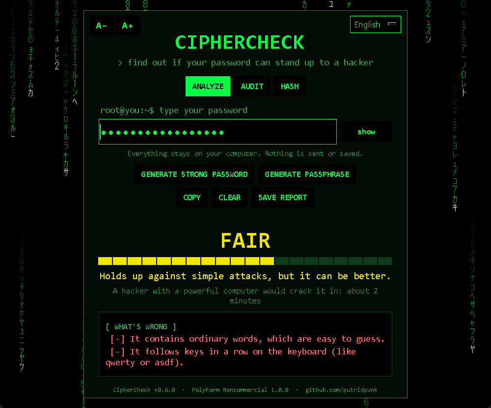
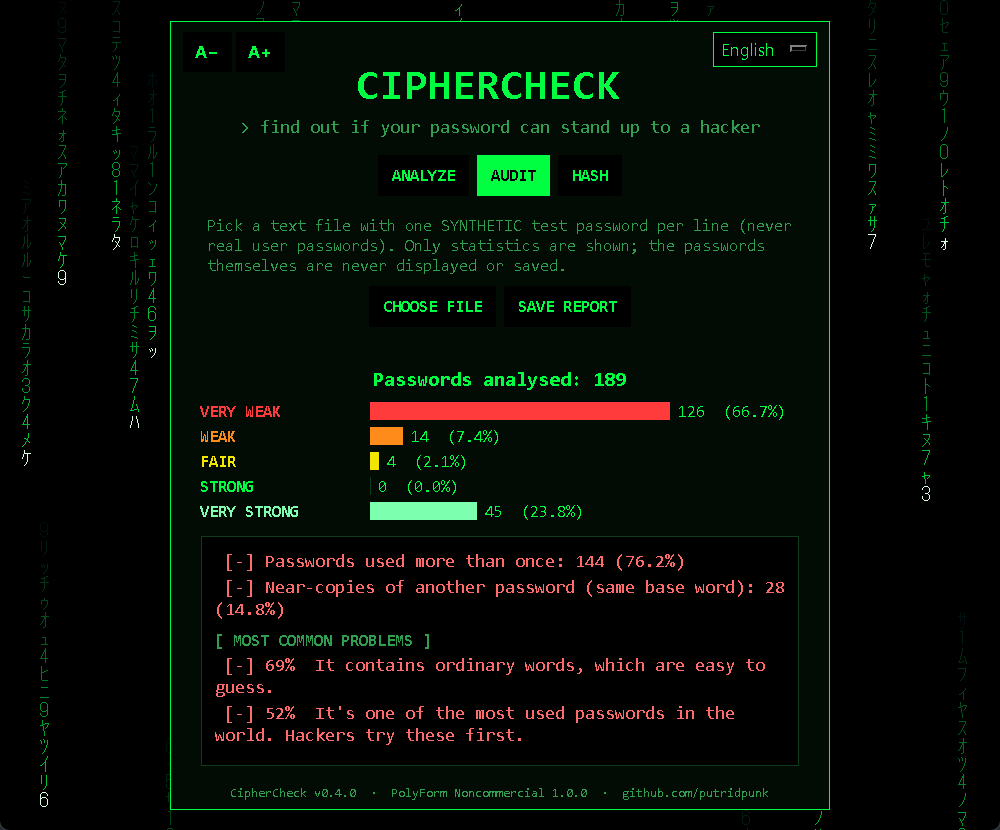
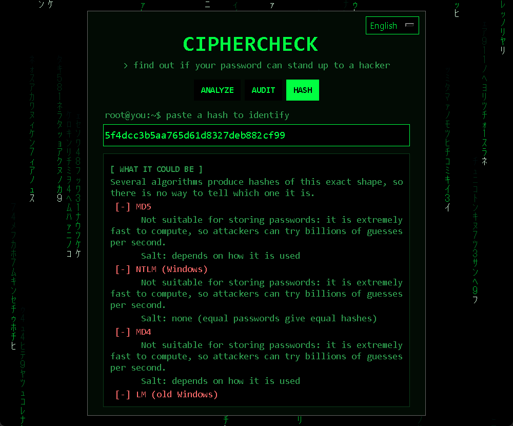

# CipherCheck

[](https://github.com/putridpunk/CipherCheck/actions/workflows/ci.yml)
[](https://github.com/putridpunk/CipherCheck/releases/latest)
[](LICENSE)


A modular password security auditing tool developed in Python. Evaluates password strength through entropy estimation, pattern recognition, dictionary-based detection and security analysis. Features local processing, automated testing and exportable security reports.

Everything runs locally: no automatic network access, no telemetry, and exported reports never contain the password. The one exception is an optional, on-demand "check for updates" (a plain request to GitHub's public release API, with no personal data); it only ever runs when you ask for it.



| Audit: statistics for a file of synthetic passwords | Hash: identify a hash format |
| --- | --- |
|  |  |

## Licence

CipherCheck is **source-available under the [PolyForm Noncommercial License 1.0.0](LICENSE)**, not open source. You may use, study and modify it for personal, educational, research and other noncommercial purposes. **Selling it, offering it as a paid product or service, or otherwise earning income from it requires the author's prior written authorization** - contact the author through [github.com/putridpunk](https://github.com/putridpunk). The bundled datasets keep their own licences (see [`src/data/README.md`](src/data/README.md)). This is not legal advice.

Contributions are welcome: see [`CONTRIBUTING.md`](CONTRIBUTING.md). Found a security problem? Please read [`SECURITY.md`](SECURITY.md) first. What changed in each version: [`CHANGELOG.md`](CHANGELOG.md).

## Desktop app

**Download** from the [latest release](https://github.com/putridpunk/CipherCheck/releases/latest):

| Platform | App | Terminal tool |
| --- | --- | --- |
| Windows | `ciphercheck-setup.exe` (installer) or `ciphercheck.exe` | `ciphercheck-cli.exe` |
| Linux | `ciphercheck-linux` | `ciphercheck-cli-linux` |
| macOS | `ciphercheck-macos.zip` | `ciphercheck-cli-macos` |

The executables are not code-signed, so Windows SmartScreen / macOS Gatekeeper may warn you the first time (Windows: More info > Run anyway; macOS: right-click > Open). The Linux and macOS builds are produced by CI and have not been tested by hand.

**Linux menu entry:** download `ciphercheck-linux-install.sh` next to the binaries and run `bash ciphercheck-linux-install.sh`. It installs for the current user (no root): the app as `~/.local/bin/ciphercheck-gui` with a "CipherCheck" menu entry and icon, and the terminal tool as `ciphercheck`. Remove it again with `--uninstall`.

**With Python (any OS):** every release also has a wheel (`ciphercheck-*.whl`). `pipx install ciphercheck-*.whl` gives you the commands `ciphercheck` (terminal) and `ciphercheck-gui` (app); add `[dnd]` for drag and drop, e.g. `pipx install "ciphercheck-0.6.0-py3-none-any.whl[dnd]"`. From a checkout: `pip install .`.

The app has a Matrix/hacker theme and speaks plain language, in 9 languages (English, Português, Español, Français, Deutsch, Русский, العربية, 日本語, 简体中文). Pick one from the menu in the top-right corner; the choice is remembered, and the first launch follows your system language.

- **Analyze**: type a password and instantly see how strong it is, what is wrong, how long a hacker would need under three attack models (fast offline hash, slow offline hash like bcrypt, and a rate-limited login page), and how to improve it. An optional field lets you check the password against your own personal information (name, birth date, pet, ...; kept only in memory, never saved) so it is flagged the way someone who knows you would guess it. *Generate strong password* turns what you typed into a strong password that still resembles it (or creates a brand-new one if the field is empty). *Generate passphrase* makes five random words from the 7,776-word EFF list (about 65 bits, easy to remember). Copying wipes the clipboard after 30 s, and *Save report* exports TXT / JSON / HTML.
- **Audit**: pick a file of **synthetic** test passwords (one per line), a **CSV, semicolon- or tab-separated export from a password manager** (the password column is found automatically, including `.tsv` files), or **drag the file onto the window**, and get a statistics dashboard: strength distribution, most common problems, passwords reused and near-copies of each other (`Summer2024!` / `summer2025`). If the export also has a site/account column, the dashboard adds two more things, naming the account but never the password: **which accounts to fix first** and **which accounts share the exact same password**. A *Policy* button checks every password against a named policy (`none` / `basic` / `nist` / `strong`), or your own via *Load policy file* (a small JSON file - see below), and reports a pass/fail breakdown; *Generate for policy* creates and copies a password that satisfies whichever one is selected, and *Export remediation list* writes a CSV with a freshly generated, policy-compliant replacement password for each weakest account. *Load banned words* flags your organisation's own terms wherever they appear, and *Load profiles file* flags each account's own personal information (from a JSON file mapping account to terms) against that account alone. *Compare with file* audits a second file and reports whether it is better or worse than the one currently loaded, without replacing it. After the first audit in a session, later audits are automatically compared with the previous one, and a short trend line appears once the local history (last 30 audits' aggregate numbers only - never a password, filename or account name) has more than one entry. Big files are analysed on all CPU cores (several times faster than one core), with a progress bar and a *Cancel* button. Passwords are never shown or saved; the summary can be exported, including as CSV. Dragging needs the optional `tkinterdnd2` package, which the release executables include.

  A profiles file looks like this (each value is a string or a list of strings; checked only against that one account):
  ```json
  {"alice@example.com": ["Alice", "1990", "Rex"], "bob@example.com": "Bob,1985"}
  ```

  A custom policy file looks like this (every field optional, falling back to the same defaults as the built-in policies):
  ```json
  {"key": "internal", "min_length": 14, "min_bits": 50, "forbid_common": true, "forbid_breached": true}
  ```
- **Hash**: paste a hash to see which formats it could be and whether they suit password storage. Only the format is checked; nothing is cracked. An educational *demo crack* button additionally tries an MD5/SHA-1 hash against the bundled 100,000 common passwords (it only ever finds one of those, never a real or salted password).

Handy extras: `Ctrl+1/2/3` switch tabs, `Ctrl+G` generates a password, `Esc` clears the current input, the `A−` / `A+` buttons (top-left) change the text size, and *check for updates* (bottom, under the footer) makes one on-demand request to GitHub to see if a newer release exists. Both the language and the text size are remembered. The footer shows the version and links to this repository.

```powershell
.\build.ps1          # Windows: runs the tests, then builds ciphercheck.exe and ciphercheck-cli.exe
python build.py      # any OS: same, output in release/ with a per-OS suffix
python ciphercheck.py   # run the app from source
```

The word and password lists are bundled inside the executables; no Python needed.

## Command line

Requires Python 3.10+ and no third-party packages (or use `ciphercheck-cli`).

```powershell
python -m src.main                       # prompts for the password (input hidden)
python -m src.main --stdin               # read one password from stdin
python -m src.main -r report.html        # also export a report (txt / json / html)
python -m src.main -f samples.txt -q -r summary.html   # batch mode: aggregate stats only
python -m src.main -f big.txt -j 4       # ... on 4 worker processes (default: automatic)
python -m src.main --hash 5f4dcc3b5aa765d61d8327deb882cf99   # identify a hash format (never cracks it)
python -m src.main --passphrase          # a random 5-word passphrase (3 to 12 words)
python -m src.main -p "example" --lang pt   # plain-language output in another language
python -m src.main -p "RexFido2010" --profile "Rex,2010"   # flag your own personal info
python -m src.main -f export.csv -P strong -r audit.csv    # policy check + CSV import/export
python -m src.main -f export.csv --policy-file my-policy.json -r audit.csv   # custom policy
python -m src.main --generate-for-policy strong          # a password that satisfies it, and exit
python -m src.main -f export.csv --banned-words-file banned.txt --profiles-file profiles.json -q
python -m src.main -f after.csv --compare-with before.csv   # was a password reset an improvement?
python -m src.main -f export.csv --remediation fixes.csv -P strong  # suggested replacement passwords
python -m src.main --check-update        # one on-demand request to GitHub; the only network use
```

`--lang` takes `en pt es fr de ru ar ja zh` and switches terminal output, `--hash` explanations, batch summaries and TXT reports to the same plain language the app uses (JSON and HTML reports stay English). `-p/--password` exists but is discouraged (it lands in shell history). Batch mode is meant for **synthetic** test data (one password per line, or a `.csv`/`.tsv` export, comma-, semicolon- or tab-separated, whose password column is detected automatically); it prints only aggregate statistics, plus, if the export has a site/account column, which accounts to fix first and which share a password (named by account, never by password). `-P/--policy` (or `--policy-file` for your own, see above) checks each password against a policy and reports pass/fail counts; every batch run also records its aggregate numbers (never a password or filename) to a small local history file that the Audit tab uses for its trend line. `--banned-words-file` (one term per line) flags your organisation's own words everywhere; `--profiles-file` (a JSON file mapping account to terms) flags one account's own personal information against that account alone. `--compare-with` audits a second file and reports whether `-f`'s file is better or worse. `--remediation` writes a CSV with a freshly generated, policy-compliant replacement password for each weakest labelled entry.

## How it works

| Module | Role |
| --- | --- |
| `src/entropy.py` | Theoretical entropy `H = L·log2(R)` **and** a pattern-aware estimate (minimum-cost cover via dynamic programming), plus crack-time estimates |
| `src/patterns.py` | Sequences, repeated characters/blocks, keyboard walks, years |
| `src/dictionary.py` | Local common-password list, word lists (incl. the EFF passphrase list), leetspeak normalisation (`p@ssw0rd` → `password`) |
| `src/breach.py` | Offline leaked-password check against `src/data/breached.bin` (nothing leaves your computer) |
| `src/profile.py` | Flags a password that contains the user's own personal information (name, date, ...), supplied only in memory, or (in batch) one account's own information from a loaded profiles file |
| `src/banned.py` | Flags a password that contains an organisation-specific banned term (its name, products, ...), loaded from a plain text file |
| `src/analyzer.py` | Combines everything into a label, score, findings and recommendations |
| `src/reuse.py` | Finds identical passwords and near-copies inside a dataset (only hashes, and - if given - account names, are kept in memory) |
| `src/audit.py` | Audits a whole file (or a CSV/TSV export's password and, if present, account columns, comma-, semicolon- or tab-separated) on all CPU cores, in chunks, with progress and cancel; only counters and account names come back, never a password |
| `src/policy.py` | Named pass/fail policies (`basic`, `nist`, `strong`, or a custom one loaded from JSON) checked against an analysis; also generates a password that satisfies one |
| `src/history.py` | A small local history of past audits' aggregate numbers (never a password, filename or account name), for the Audit tab's trend line |
| `src/crack_demo.py` | Educational demo: tries to match an MD5/SHA-1 hash against the bundled 100,000 common passwords |
| `src/update_check.py` | The app's only network access: an on-demand, opt-in check against GitHub's release API |
| `src/report.py` | TXT / JSON / HTML / CSV reports, batch aggregation, audit-to-audit comparison and translated plain-language text |
| `src/vulnerabilities.py` | Turns an analysis into categorised weaknesses (severity, why it matters, how to fix) for the detailed reports |
| `src/hashes.py` | Identifies hash formats (MD5, SHA-*, bcrypt, Argon2, ...) and explains their password-storage properties; a format match is a hint, never proof of origin |
| `src/friendly.py` | Plain-language explanations, the password generators and the "similar but strong" password |
| `src/i18n.py`, `src/locales/` | Translations (one file per language; `en.py` is the master, a test checks every locale has the same keys and placeholders) |
| `src/settings.py` | Remembers the chosen language in a small per-user JSON file |
| `src/gui/` | Matrix-themed desktop app (tkinter): `app.py` window and tabs, `analyze_tab.py`, `audit_tab.py`, `hash_tab.py`, `widgets.py` themed widget factory, `rain.py` background, `theme.py` colours and per-OS fonts |
| `src/main.py` | Command line |

Theoretical entropy assumes uniformly random characters, so it overestimates human-chosen passwords (`P@ssw0rd!` has ~59 theoretical bits but is a top-tier guess). The **estimated** figure is what drives the verdict. Special characters are reported but never treated as a strength on their own.

Assessment thresholds (estimated bits): `<28` very weak · `<40` weak · `<60` moderate · `<80` strong · otherwise very strong. Passwords under 8 characters are capped at weak.

## Limits and honesty

- Arabic is shaped and right-aligned correctly, but Tk has no right-to-left paragraph support, so punctuation and the `[-]` markers can sit on the wrong side of a line.
- The translations are not yet reviewed by native speakers (corrections welcome, see `CONTRIBUTING.md`).
- Bundled data (see `src/data/README.md`): the 100k most common passwords and an 8k-word vocabulary for scoring, plus an offline index of the ~1M most common leaked passwords. The leak check is not a complete breach database: not being found does not prove a password never leaked.
- Entropy and crack-time numbers are models, not guarantees.
- `correct-horse-battery` scores *moderate* (~43 bits): three common words are not enough. It is flagged as a passphrase, and five random words reach strong.
- The *demo crack* button (Hash tab) is a teaching aid, not a cracking tool: it can only ever find one of the 100,000 bundled common passwords, hashed with no salt. It proves nothing about a real, unique or salted hash.
- The CSV progress bar for very large password-manager exports is an estimate (Python cannot report an exact file position while iterating a CSV reader); the final count is always exact.
- *Check for updates* is the only thing in CipherCheck that uses the network, and only runs when you click the button or pass `--check-update`; it sends nothing but a request to GitHub's public release API.
- "Fix these first" and "accounts that share a password" show whatever is in your CSV's site/account column, as-is (truncated to 80 characters). Keep that column to short account names; it is shown in the dashboard and reports, so avoid putting anything sensitive there.
- The remediation CSV's suggested passwords are freshly random and policy-compliant, never derived from or related to the real password; they still need to actually be set on the account (CipherCheck never changes anything on your behalf).

## Tests

```powershell
python -m unittest discover -s tests -t .
```

CI also builds the wheel and runs it in a clean environment, and runs `ruff` (rules in `ruff.toml`), `mypy` (`mypy.ini`) and a coverage report that must stay at or above 80% (currently ~88%). To check locally: `pip install ruff mypy coverage`, then `ruff check .`, `mypy` and `coverage run -m unittest discover -s tests -t . && coverage report`. Line endings are normalised to LF by `.gitattributes`.

## Continuous integration

`.github/workflows/ci.yml` runs the tests on Linux, Windows and macOS (Python 3.10 and 3.13; the GUI smoke tests run under a virtual display on Linux). `.github/workflows/release.yml` builds the executables on all three systems, the Windows installer (`installer/ciphercheck.iss`, Inno Setup), the Linux install script and the Python wheel; pushing a tag such as `v0.4.0` attaches them to a GitHub Release, and running it manually only produces downloadable artifacts. Dependabot keeps the GitHub Actions versions current.

## Roadmap

1. ~~Foundation, analysis, reporting, hash analysis, audit dashboard, offline leak check, CI, installer, passphrases, translated CLI~~ (done)
2. Native-speaker review of the translations
3. Code signing for the executables
4. Optional C++ analysis engine
